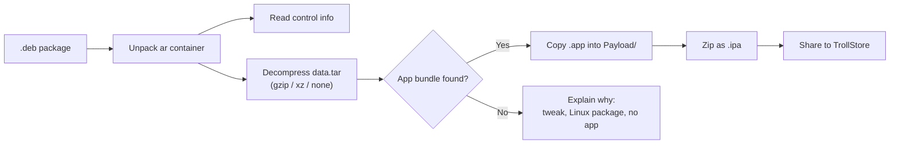

<div align="center">


# Deb to IPA

**Convert jailbreak `.deb` packages into installable `.ipa` files, right on your iPhone or iPad.**


[Features](#features) •
[Install](#install) •
[Usage](#usage) •
[Build from source](#build-from-source) •
[Limitations](#limitations) •
[FAQ](#faq)

</div>

---

## About

Many apps from Cydia, Sileo and Zebra are distributed as `.deb` packages, which only install on jailbroken devices. **Deb to IPA** pulls the app out of such a package and repackages it as an `.ipa`, which you can then install with [TrollStore](https://github.com/opa334/TrollStore).

Everything happens **locally on your device**. Nothing is uploaded anywhere.

## Features

- 📦 **On-device conversion:** no computer and no internet connection needed
- 🔍 **Finds apps automatically** in both rootful (`/Applications`) and rootless (`/var/jb/Applications`) packages
- 🧩 **Handles packages with several apps** and creates one `.ipa` for each
- 🚫 **Explains what can't be converted:** tweaks, Linux packages, libraries and damaged files each get a clear message
- ⚠️ **Warns about likely problems,** such as apps that depend on jailbreak files
- 📤 **One-tap install:** send the result straight to TrollStore from the share sheet
- 🗂️ **Keeps converted files** in the app and in the Files app
- 📥 **Opens `.deb` files from anywhere:** Files, Safari downloads or any share sheet

## How it works



An `.ipa` is simply a zip file with the app inside a `Payload` folder. Deb to IPA builds exactly that while keeping file permissions, symlinks and the app's main program intact.

## What can be converted?

| Package type | Converts? | Notes |
| --- | :---: | --- |
| Jailbreak app (`/Applications/*.app`) | ✅ | The main use case |
| Rootless jailbreak app (`/var/jb/Applications/*.app`) | ✅ | May need jailbreak files to run |
| Tweak (MobileSubstrate / ElleKit) | ❌ | There's no app inside, only changes to other apps |
| Library, command-line tool or theme | ❌ | There's no app to package |
| Linux / desktop `.deb` (amd64, arm64, …) | ❌ | Built for another operating system |

## Requirements

- iPhone or iPad running **iOS 15 or later**
- **[TrollStore](https://github.com/opa334/TrollStore)** installed (supported iOS versions depend on TrollStore)

## Install

1. Open the **[Actions](../../actions)** tab of this repository.
2. Select the latest successful **Build Deb to IPA** run.
3. Download **DebToIPA-ipa** under **Artifacts** (you must be signed in to GitHub).
4. In the Files app, tap the downloaded zip to unpack it.
5. Share `DebToIPA.ipa` to **TrollStore** and tap **Install**.

> [!TIP]
> If there is no successful run yet, open **Actions → Build Deb to IPA → Run workflow** to start one.

## Usage

1. Open **Deb to IPA**.
2. Tap **Choose a .deb file**, or share a `.deb` to *Deb to IPA* from Files or Safari.
3. Wait for the conversion to finish.
4. Tap **Install with TrollStore…** and choose **TrollStore** in the share sheet.

Converted files are saved here:

```
Files → On My iPhone → Deb to IPA → Converted
```

Swipe left on a file in the app to delete it.

## Build from source

### Option A: GitHub Actions (no Mac needed)

This repository includes a workflow at [`.github/workflows/build.yml`](.github/workflows/build.yml) that runs on every push. It:

1. generates the Xcode project with [XcodeGen](https://github.com/yonaskolb/XcodeGen)
2. builds an unsigned `arm64` app with `xcodebuild`
3. fake-signs it with `ldid` (or ad-hoc `codesign` as a fallback)
4. packages it as `DebToIPA.ipa` and uploads it as a build artifact

To build your own copy, fork this repository and open the **Actions** tab.

### Option B: On a Mac

```bash
brew install xcodegen ldid
git clone https://github.com/<your-username>/<your-repo>.git
cd <your-repo>
xcodegen generate
open DebToIPA.xcodeproj
```

To make a TrollStore-ready `.ipa` from the command line:

```bash
xcodebuild -project DebToIPA.xcodeproj -target DebToIPA \
  -configuration Release -sdk iphoneos ARCHS=arm64 \
  CODE_SIGNING_ALLOWED=NO CODE_SIGNING_REQUIRED=NO CODE_SIGN_IDENTITY="" \
  CONFIGURATION_BUILD_DIR="$PWD/build" build

ldid -S build/DebToIPA.app/DebToIPA
mkdir -p Payload && cp -R build/DebToIPA.app Payload/
zip -qry DebToIPA.ipa Payload
```

## Project structure

```
.
├── .github/workflows/build.yml   # Cloud build that produces the .ipa
├── project.yml                   # XcodeGen project definition
├── Info.plist                    # App settings, .deb file type, Files app access
└── Sources/
    ├── DebToIPAApp.swift         # App entry point
    ├── ContentView.swift         # Main screen
    ├── ConverterModel.swift      # Screen state and background conversion
    ├── DebConverter.swift        # Finds apps and builds the .ipa
    ├── ArArchive.swift           # Reads the .deb (ar) container
    ├── TarArchive.swift          # Reads ustar / GNU / PAX tar archives
    ├── Decompressor.swift        # gzip and xz via Apple's Compression framework
    ├── ZipWriter.swift           # Writes the .ipa (zip) with permissions and symlinks
    ├── ShareSheet.swift          # System share sheet
    ├── Errors.swift              # User-facing error messages
    └── Assets.xcassets/          # App icon
```

The app uses only Apple frameworks (SwiftUI, Foundation, Compression). It has **no third-party dependencies**.

## Limitations

- **Compression:** gzip, xz and uncompressed packages are supported. **Zstandard (`.zst`)**, **bzip2** and legacy **LZMA** are not supported yet.
- **Jailbreak dependencies:** apps made for jailbroken devices may expect jailbreak files, tweaks or system access, so some won't fully work after installing with TrollStore.
- **Extra package contents:** helpers, daemons, preference bundles and other files outside the `.app` can't be included in an `.ipa`. The app warns you when a package contains them.
- **Size:** each `.ipa` is limited to 4 GB and 65,535 files (no Zip64).
- **Signing:** the generated `.ipa` is unsigned. TrollStore handles this; other sideloading tools will re-sign it.

## Troubleshooting

<details>
<summary><b>"This package is compressed with Zstandard…"</b></summary>

The package uses a compression format that isn't supported yet. Look for another build of the package, or open an issue.
</details>

<details>
<summary><b>"This is a tweak, not an app."</b></summary>

Tweaks change other apps or the system and have no app to extract. They need a jailbreak.
</details>

<details>
<summary><b>The converted app installs but crashes on launch</b></summary>

The app probably depends on jailbreak files (common with rootless packages). This can't be fixed by conversion alone.
</details>

<details>
<summary><b>TrollStore doesn't appear in the share sheet</b></summary>

Scroll the row of apps to the end and tap <b>More</b> to enable TrollStore, or open the <code>.ipa</code> from the Files app instead.
</details>

<details>
<summary><b>The GitHub build fails</b></summary>

Open the failed run in the <b>Actions</b> tab, expand the red step, and include its log when you open an issue.
</details>

## FAQ

**Does this work without a jailbreak?**
Yes. The converter itself only needs TrollStore. Whether the *converted* app works without a jailbreak depends on that app.

**Is anything uploaded?**
No. Conversion runs entirely on your device.

**Can I convert Linux `.deb` files to run on iOS?**
No. They are built for a different operating system and processor setup.

## Contributing

Issues and pull requests are welcome. Support for Zstandard-compressed packages would be especially useful.

## Disclaimer

This project is not affiliated with TrollStore, Cydia, Sileo or Zebra. Only convert packages you are allowed to use and redistribute. Use at your own risk.
